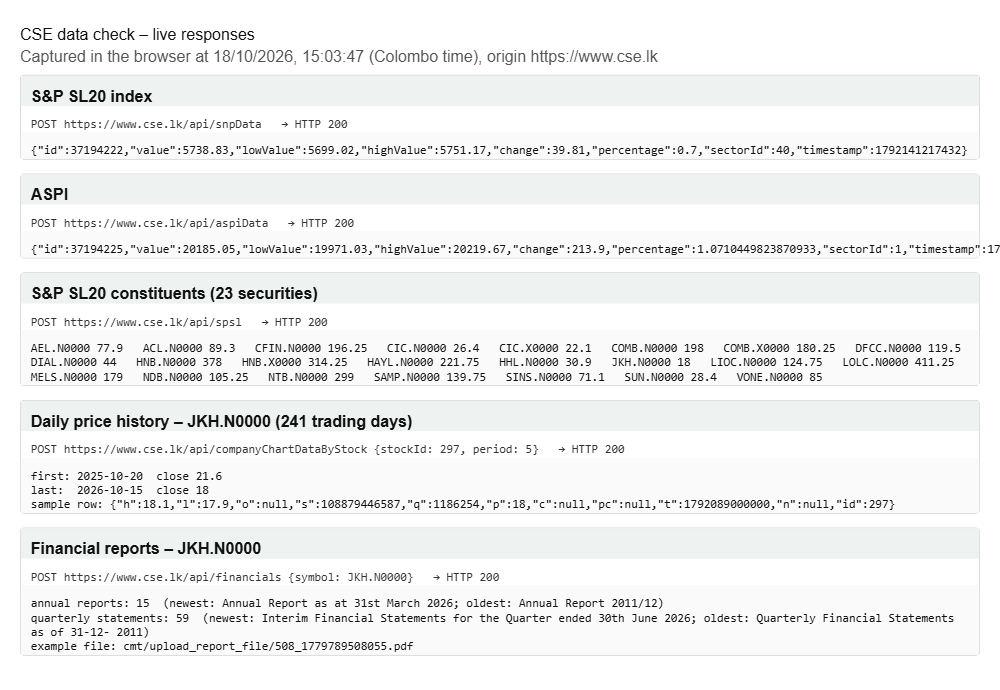
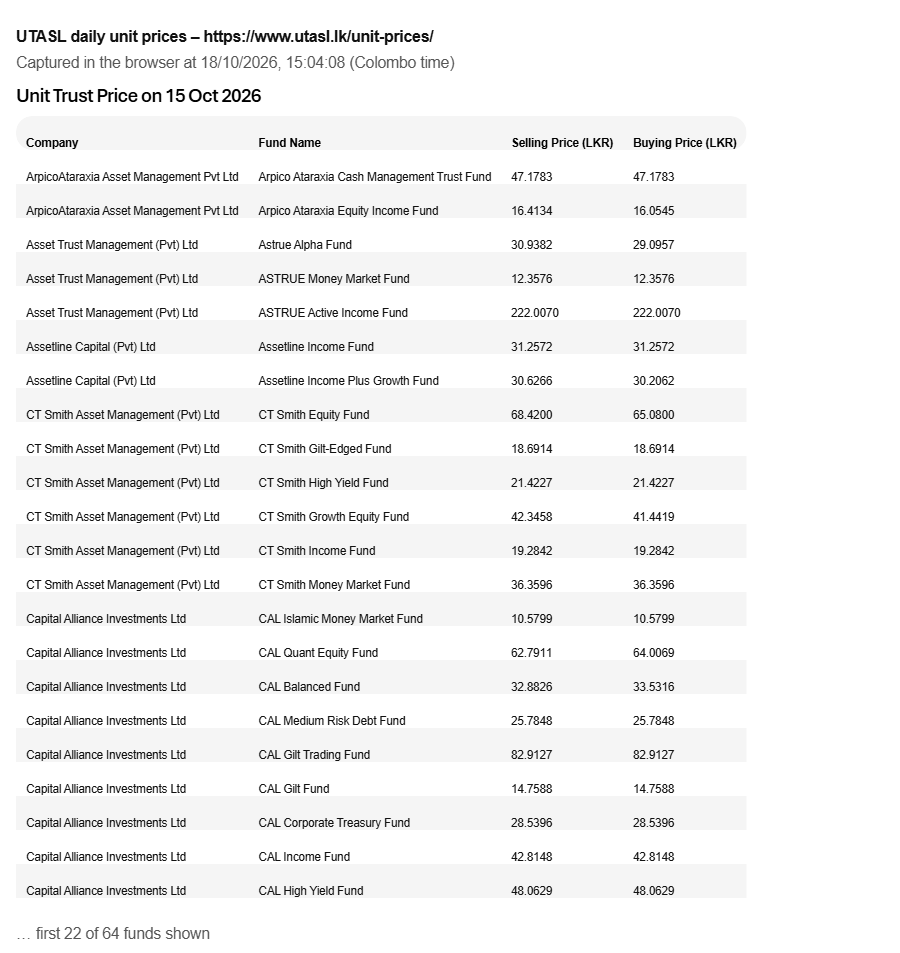
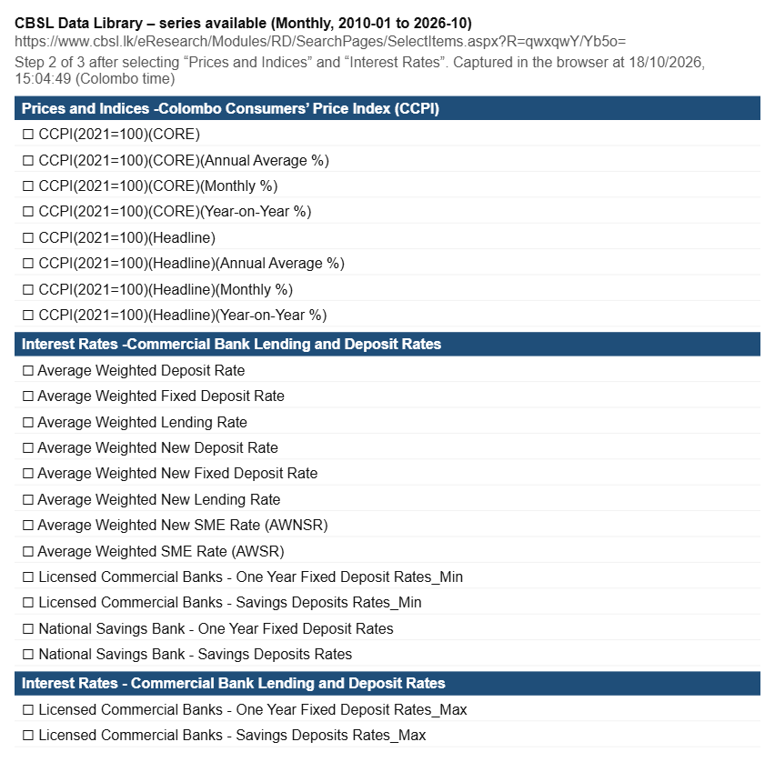
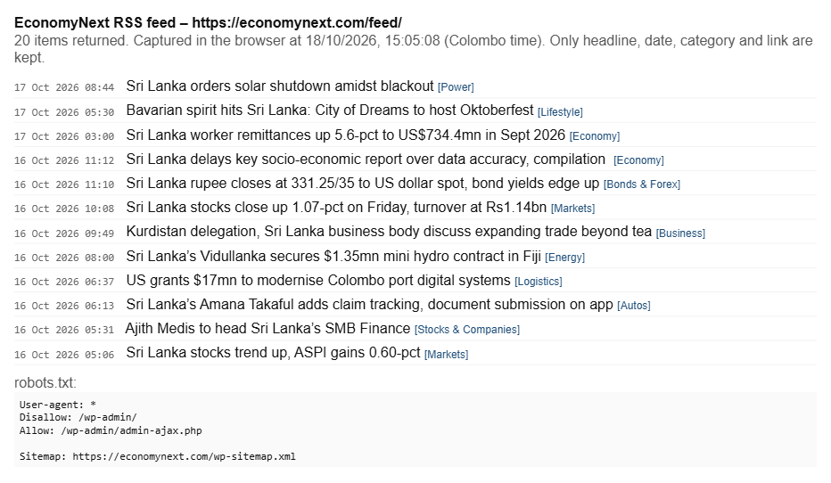

# 1. Problem statement and definition

Sri Lankans who manage to save some money usually leave it in a savings account or a fixed deposit (FD), because that is what they know. The problem we are tackling is narrower than "people don't invest": a person with savings has no simple, honest way to see how to split that money across the options actually open to them (savings, FDs, Treasury bills and bonds, unit trusts and listed shares), what each split could realistically return, and how likely it is to lose money. So they default to the FD, even when the FD is quietly losing value after inflation.

**Who is affected and how many.** Bank deposits are still the default home for household savings. Unit trusts, which were introduced in 1991, still make up only about 1.5% of the financial assets held by the public, and the whole industry had about 137,000 unit holders at the end of October 2025 [7]. The Central Depository System passed 1 million registered share accounts only recently [8], but a large registered base has never meant a large active one: in 2015, when there were about 765,000 CDS accounts, only around 25,000 were actively trading [9]. In a country of about 22 million people, that leaves millions of savers who have never held anything except a deposit.

New money is starting to move. With deposit rates down, 44,047 new CDS accounts were opened in the first ten months of 2025 against 14,062 in the same period of 2024, mostly by local individuals, and analysts warned that many were inexperienced investors chasing yield [10]. These are exactly the people who need a sober picture of risk before they act.

**What it costs them today.** CBSL's own numbers show the gap. In the first quarter of 2026 the average rate banks paid on new fixed deposits (AWNFDR) was between 6.5% and 7.0% [3], while headline CCPI inflation reached 8.0% in August and stayed there in September 2026 [2]. A Rs 500,000 FD opened at 7.0% earns Rs 35,000 in a year, but prices rise by about Rs 40,000 over the same year, so the saver ends the year roughly Rs 5,000 poorer in real terms (about -0.9%). Most savers never see this, because the bank statement only shows the nominal interest. We will recompute this with the latest monthly AWNFDR once our pipeline pulls it; the point is the sign, not the decimal.

**How people cope now, and why it is not enough.** People ask a relative, a bank officer or a broker, or they follow social media tips. Each source has a bias: a bank officer sells deposits, a broker sells trading, and a fund manager sells their own funds. Financial literacy is also patchy. CBSL's 2021 national survey found 57.9% of adults financially literate, which still leaves around four in ten adults who are not [11]. The public tools that exist (section 3) show prices and rates one product at a time. None of them takes a person's own amount, horizon and risk comfort and shows a whole split with an honest range of outcomes.

# 2. The user

Our user is **Mrs Nadeesha Perera, 45, a salaried employee in Colombo with about Rs 500,000 saved**. Her money sits in a savings account and one FD at her bank. She has heard about unit trusts and the share market from colleagues but does not know where to start or how much is "safe" to move. She is the beginner we design for first. More detail is available on click for people who already invest.

**The decision she is making:** "How should I split my money right now, given how much risk I can take and when I might need it back?" She makes this decision when an FD matures (every 6 to 12 months), when a bonus or salary increment arrives, and again when rates move sharply.

**What she decides on today:** the FD rate board at her branch, what a bank officer recommends, and the occasional news headline about the stock market. She does not see her real (after-inflation) return, she does not see T-bill yields, and she has no way to compare a mix of products on equal terms.

**What changes if our system exists:** she signs in, answers a short risk questionnaire and gives her age, amount and horizon, and picks from the instruments that suit her risk profile. She gets one personal split across them, a likely, bad and good case for how the money could grow, the chance of ending below what she put in, and the same money left in an FD after inflation, side by side. Every number shows the date of the data behind it. Next to the plan she can see how healthy each suggested company is and how this week's news may affect it. She can then take that picture to her bank or a licensed adviser and ask better questions. The tool is educational and says clearly that it is not financial advice.

# 3. Literature review

**Portfolio theory.** Markowitz (1952) showed that the risk of a portfolio depends on how its parts move together, not just on each part alone, and that for any level of risk there is a best possible mix (the efficient frontier) [12]. This is the basis of every allocation tool, including ours. Its known weakness is that it is very sensitive to the expected returns you feed it: small errors in forecasts produce extreme, unstable portfolios. DeMiguel, Garlappi and Uppal (2009) found that across many datasets, optimised portfolios often failed to beat a simple equal-weight (1/N) split out of sample [13]. For us this means two things: we must keep the optimiser constrained and simple, and we must always test it against a naive baseline.

**Forecasting returns.** Time-series models such as ARIMA (Box and Jenkins) and Prophet (Taylor and Letham, 2018) are widely used for monthly and daily economic series [14][15]. For asset returns, however, a long line of research finds that the historical average is very hard to beat; Welch and Goyal (2008) showed that most predictors of equity returns do no better than the historical mean out of sample [16]. We take this seriously: our forecasts are useful only if they beat the historical-average baseline on held-out data, and we will report honestly if they do not.

**Measuring risk and the chance of loss.** Monte Carlo simulation, drawing many possible future paths from the estimated returns and volatility, is the standard way to turn a forecast into a range of outcomes and a probability of loss [17]. It is easy to explain to a beginner ("we ran the next three years 10,000 times") and it handles a mix of assets naturally.

**Fundamental analysis and news.** Piotroski (2000) showed that nine simple yes/no tests on two years of financial statements separate stronger from weaker companies [34], and Altman's Z-score (1968) is a long-standing warning sign of financial distress [35]. Both are transparent and can be explained line by line, which suits our users. To measure how news moves prices, the standard tool is the event study: compare a share's return around the news day with what the market did [36].

**Robo-advisors.** Services such as Betterment in the US automate allocation using a risk questionnaire and modern portfolio theory [18]. They show that a short quiz plus a constrained optimiser works for ordinary savers. They do not operate in Sri Lanka, use foreign assets, and ignore the instruments a Sri Lankan actually has (FDs, Treasury bills, local unit trusts).

**Sri Lankan tools.**

| Tool | What it does | Where it falls short for Nadeesha |
|---|---|---|
| LankaBizz [19] | Market-data site: rate, inflation, FX and gold trackers, CSE screener, unit trust explorer, news, AI stock picks and an AI chat | Shows data product by product. It never tells a person how to split their own money, and does not show a range of outcomes or chance of loss for a whole plan |
| Waraka.lk [20] | Portfolio tracking and projection for people who already hold investments | Starts from a portfolio you already have; does not help a beginner decide the first split |
| Broker and fund-manager apps (e.g. CAL Online, First Capital) [21][22] | Let clients buy and track that firm's own unit trusts, treasuries and shares | Show only that firm's products; the advice is not independent of what they sell |
| Softlogic StockGPT [23] | AI research assistant on CSE-listed companies | For stock research, not for splitting savings across deposits, bills and funds |
| CeyPort [24] | CSE market dashboard, heatmaps, dividends, portfolio tracker | Stocks only; no allocation or chance of loss |
| CBSL, CSE and UTASL websites [25][26][28] | Publish the official rates, prices and unit prices | Raw data, spread across three sites, with no interpretation |
| JB Vantage (JB Financial) [38] | Fund manager with four unit trusts matched to different risk levels (money market, short-term gilt, credit, equity) and published returns after fees | Shows its own funds only; the investor still has to work out which mix suits their age and risk |
| FastBull [39] | Global 24/7 news flashes, economic calendar and charts | Global and trader-focused; does not explain what a story means for Sri Lankan sectors or a saver's plan |
| First Guardian Equities market insight [27] | Weekly and monthly market commentary from a licensed broker | Useful context for experienced investors, but general, not personal |

**The gap.** The data needed to answer Nadeesha's question is public, but it is scattered, and nobody combines it into one personal split with an honest range and chance of loss across all of the options open to her. Our system fills that gap, and it is built to admit when the data is too thin to say anything confident.

# 4. Proposed solution

**What the system does.** A website where a Sri Lankan saver signs in, is greeted by name ("Welcome back, Mrs Perera"), and gets a plan built around them. It is made of three models that feed into each other, an idea we refined with a stock market professional we consulted.

**Model 1 – Customer identification.** The user answers a short risk questionnaire (time horizon, how they would react to a 10% fall, how stable their income is, past experience, whether they may need the money early). The answers are scored into one of five risk profiles, from very conservative to aggressive. Each profile unlocks a set of suitable instruments; a very conservative user sees savings, FDs, T-bills and money market funds, while an aggressive user can also choose equity funds and S&P SL20 shares. The user picks the instruments they are comfortable with. The model then uses their **age** and horizon to set how much goes into each one: younger savers with long horizons can hold more growth assets, and the share in safer, income-paying products rises with age. The instrument menu follows the way Sri Lankan fund managers organise their products. JB Vantage, for example, offers a money market fund, a short-term gilt fund, a credit fund and an equity fund, each aimed at a different risk level [38]. The age rule (a glide path from growth to safer products) is our own and will be checked with the market professional we consulted.

**Model 2 – Fundamental analysis.** For each S&P SL20 company we read the annual and quarterly financial statements published on the CSE website and turn them into a **company health score** with a short explanation. The score has five parts: profitability and growth, financial strength, earnings quality, valuation, and management and governance. Rather than a league table, each company gets a grade (A to E) with the reasons behind it, compared with its own sector, so a user can see why a company looks strong or weak. Prices and the score are shown on TradingView-style charts.

**Model 3 – News and chain reactions.** News rarely hits one share directly; it travels. A rise in world oil prices raises fuel and transport costs, which squeezes manufacturers and airlines, can help the oil distributor, and pushes inflation up, which can lead to higher interest rates, which hurts banks' bond holdings and helps savers in FDs. Model 3 works like a 24/7 news flash with an economic calendar, the format FastBull uses [39], but for Sri Lanka. It reads daily headlines from local sources, CSE announcements and CBSL releases, tags each one with the economic factor it moves (oil, interest rates, the rupee, tourism, tax, weather and so on), and follows a **factor → sector → company** chain to show which industries and companies are likely to be affected and in which direction.

**Bringing them together.** The fundamental score (how healthy a company is, a slow-moving view) and the news chain (what is likely to push it now, a fast-moving view) are combined into an **outlook** for each company, sector and the market as a whole: positive, neutral or negative for the next one to three months, always with a confidence level and the evidence behind it. Model 1 then uses these outlooks when it fills the share and equity-fund part of the user's plan.

**What the user sees.** One personal split across the instruments they chose, with rupee amounts; a likely, bad and good case for how the money could grow (from a Monte Carlo simulation); the chance of ending below what they put in; expected monthly income; and the same money in an FD after inflation, side by side. Every number shows the date of its data.

**The insight it produces.** Not prices, but a personal answer the user could not get elsewhere. For example: *"Mrs Perera, your FD at 7.0% is losing about 0.9% a year after 8.0% inflation. For a moderate profile at 45, this split (mostly T-bills and an income fund, with 15% in two A-graded S&P SL20 companies) has a likely return of X% a year over 3 years and about a Y% chance of ending below your Rs 500,000. Note: this week's rise in oil prices is negative for one of your companies' sector; confidence is low."* X and Y will come from the models on real data; we will not put numbers there until the models produce them.

**Why she could not reach this alone.** It would mean collecting rates from CBSL, prices and financial statements from the CSE, reading 20 annual reports, following the news and working out who it affects, then running a simulation. That is weeks of analyst work. Just as important, the system says when it does not know: if data is too short or old, or a model does not beat its simple baseline, it says so on screen and falls back to the simpler estimate.

# 5. Data

## 5.1 Source and access

We only use data from Sri Lankan official or authorised sources: the Central Bank of Sri Lanka (CBSL), the Colombo Stock Exchange (CSE), the Department of Census and Statistics (DCS), the Unit Trust Association of Sri Lanka (UTASL, whose members are SEC-licensed) and established Sri Lankan news outlets. None of the market data is about identifiable people. We tested the main sources on 16–18 October 2026 from a normal browser:

| Data | Source | What we confirmed (16–18 Oct 2026) | Coverage |
|---|---|---|---|
| S&P SL20 constituents and prices, ASPI and S&P SL20 index | CSE website data endpoints used by cse.lk itself [25] | S&P SL20 = 5,738.83 and ASPI = 20,185.05; 23 listed securities in the S&P SL20 list (20 companies plus non-voting shares); 241 daily price bars for John Keells (JKH) from 21 Oct 2025 to 16 Oct 2026; 240 daily index values | About 1 year of daily history. Longer periods return nothing |
| Annual reports and quarterly financial statements (Model 2) | CSE company pages, "financials" endpoint [25] | For JKH: 15 annual reports (2011/12 to 31 Mar 2026) and 59 quarterly statements (from Dec 2011 to June 2026) listed with their PDF file paths | PDFs, about 15 years per company |
| Company announcements (Model 3) | CSE announcements endpoints [25] | Approved announcements and new financial-statement filings returned for 16 Oct 2026 | Live |
| Inflation, deposit rates, T-bill and T-bond yields, exchange rates, oil prices, tourism (Models 1 and 3) | CBSL Data Library and Daily/Weekly Economic Indicators [4][28] | CCPI (2021=100), AWFDR, AWNFDR, bank FD and savings rates listed as monthly series; T-bill yields of about 9.3–10.0% on 14 Oct 2026 | Monthly, many years; daily for yields and FX |
| Unit trust prices | UTASL daily unit prices and monthly performance data [26] | Daily prices for about 65–80 funds, latest 15 Oct 2026 | Daily from Jan 2026; monthly reports from 2025 |
| Population by age, household income and spending (Model 1 context) | Department of Census and Statistics [33] | Public survey reports and microdata catalogue | Census and survey years |
| News headlines and global factors (Model 3) | EconomyNext RSS [30], CBSL press releases, CSE announcements; Daily FT where its terms allow. Global factor values (crude oil, US dollar) from CBSL's Weekly Economic Indicators [5] | EconomyNext feed returned 20 items, latest 17 Oct 2026 | Live; we keep our own archive |

**Data check evidence.** We captured each source live in the browser on 18 October 2026. The images below are in our repository (docs/evidence/), together with the notes in docs/data_sources.md.

| Source | Checked by | Date | Evidence |
|---|---|---|---|
| CSE prices, index history and financial reports | Member 2 | 18 Oct 2026 | Figure 1 |
| UTASL unit prices | Member 2 | 18 Oct 2026 | Figure 2 |
| CBSL Data Library series | Member 2 | 18 Oct 2026 | Figure 3 |
| News feed (EconomyNext RSS) | Member 2 | 18 Oct 2026 | Figure 4 |









**Licence and permission.** CBSL and DCS publish their statistics for public use. Listed companies publish their financial statements through the CSE because the listing rules require it, so they are public documents. The robots.txt files of cse.lk, utasl.lk and economynext.com allow general crawling (CSE blocks only /cgi-bin/). We have not yet found written terms of use for the CSE data endpoints, so we will keep to one small pull per day, credit the CSE on every number, and email the CSE to confirm before the final. From news we keep only headlines, links and our own scores, never article text.

**Personal data.** The login stores only a title, first name, email, questionnaire answers and saved plans. We do not ask for income, NIC or account numbers. Users can delete their account and data.

## 5.2 Extraction method

- **CSE prices and announcements:** a Python script calls the JSON endpoints the CSE website itself uses, once a day after market close, pausing between requests. We chose this over scraping HTML because it is cleaner and lighter on their server, and over paid feeds because we have no budget.
- **Financial statements:** the script downloads the annual and quarterly report PDFs for the S&P SL20 companies. We extract the income statement, balance sheet and cash flow figures with pdfplumber, and check every extracted figure by hand against the PDF for the first pass, because report layouts differ between companies and years. Management and governance items (auditor's opinion, board composition, related-party disclosures) are read from the annual reports using a fixed checklist.
- **CBSL:** the Data Library is a web form with no API, so we export the monthly series as CSV and load them with a script. Daily yields and exchange rates come from the Daily Economic Indicators.
- **UTASL:** a daily pull of the unit price table plus monthly performance data.
- **News:** RSS feeds and official press release pages only.

A scheduled GitHub Action runs the pulls every day and commits the cleaned files, so every update shows in the git history.

**Cleaning, and what we expect to be wrong:**
- Share prices are not adjusted for dividends, rights issues or splits, so a split looks like a crash. We detect large jumps and check them against CSE corporate announcements.
- Banks and finance companies (about half of the S&P SL20) report differently from other companies, so they need their own ratios (capital adequacy, non-performing loans, cost-to-income) instead of ratios like the current ratio.
- Financial years differ (most end in March, banks in December), and some companies restate past figures. We align by period end date and use the latest restated figure.
- PDF extraction will make mistakes on scanned or unusual layouts. Hand checks catch them in the first pass; later we flag any ratio that moves more than a set amount for review.
- The CCPI base year changed (2013 to 2021); we join the two series using the overlapping months.

## 5.3 Temporality

We use **historical data to build and test the models, and a daily live refresh for the plan the user sees.**

- **Historical:** about 15 years of annual and quarterly financial statements (Model 2), monthly CBSL rates and economic series going back many years (Models 1 and 3), about 1 year of daily CSE prices, and unit trust prices from January 2026.
- **Live, refreshed daily:** prices, yields, rates, unit prices and news. A user deciding today needs today's rates and this week's news; a six-month-old FD rate would give the wrong answer. Financial statements change only when a company files (every quarter), so Model 2 updates when a new filing appears in the CSE announcements.
- Every number on screen carries a "data as of" date.

**Our weak point** is that the CSE gives only about one year of daily prices, which is short for measuring share price risk and for testing news effects. We start archiving daily from now, use CBSL's longer monthly share market series for market-wide risk, and widen the ranges and show a warning when the history behind a number is short.

**When a source is unavailable**, the site keeps showing the last good value with its date, adds a "stale" label after a set number of days, and the models fall back to their simple baselines. Old data is never shown as new.

# 6. Approach and methodology

**Model 1 – Customer identification (rule-based scoring, then optimisation).**
1. Questionnaire of 6–8 questions, each scored; the total puts the user in one of five risk profiles. We base the questions on the risk-profiling forms Sri Lankan fund managers and brokers already use, so the result matches what an adviser would say.
2. A fixed table maps each profile to allowed instruments and limits (for example, no direct shares for very conservative users, at least a set share in liquid products if money may be needed early).
3. Age and horizon set the mix between growth and safe products along a lifecycle glide path. Within those limits, a mean-variance optimiser chooses the weights from the return and risk estimates below.
4. Return estimates: published rates for savings, FDs, T-bills and T-bonds (after withholding tax); for unit trusts and shares, time-series models (ARIMA, and Prophet where there is seasonality) compared with a **historical-average baseline** on held-out data. Whichever does better out of sample is used; if neither is clearly better, the baseline is used.
5. Monte Carlo simulation (10,000 paths) gives the likely, bad and good case, the chance of loss and the FD-after-inflation line.

We chose transparent scoring over a machine-learning classifier for the questionnaire because we have no labelled data on real investors, and because a user and a regulator should be able to see exactly why they were placed in a profile.

**Model 2 – Fundamental analysis (company health score).** Each company is scored 0–100 from five pillars, then graded A to E:
- *Profitability and growth:* return on equity, profit margin, earnings growth over 3–5 years.
- *Financial strength:* debt to equity and interest cover; for banks, capital adequacy and non-performing loan ratio.
- *Earnings quality:* whether operating cash flow backs up reported profit, and the nine yes/no tests of the Piotroski F-score [34], which only need two years of statements.
- *Valuation:* price to earnings and price to book compared with the company's own history and its sector.
- *Management and governance:* a checklist read from the annual report: clean audit opinion, share of independent directors, consistency of ROE and dividends over five years, whether past targets in the chairman's or CEO's review were met, and related-party transactions. This is how we judge "how well the company is run" with evidence rather than opinion.

Each pillar is scored against the company's own sector, so a bank is compared with banks. The output is a grade with the three strongest and weakest points in plain words, not just a rank. We also run the Altman Z-score [35] for non-financial companies as a simple distress warning.

**Model 3 – News chain reaction.**
1. *Read and classify:* each headline is linked to companies and sectors by name and keywords, and classified by event type and direction (for example "oil price up", "policy rate cut", "tourist arrivals down") using an LLM if we get free student credits, otherwise FinBERT [31] plus keyword rules.
2. *Chain:* a factor → sector → company map. The links and their signs come from two places: the professional's knowledge written down as rules, and the data, by checking how sector index returns moved when the factor changed in the past (monthly CBSL series against CSE sector indices).
3. *Company exposure* comes from Model 2's data, for example revenue mix, import dependence and foreign-currency debt from the annual report.
4. *Combine:* outlook = fundamental score (long-term) adjusted by the news effect (short-term), reported as positive, neutral or negative over one to three months, with a confidence level that falls when the data behind it is thin.

We will test how far news actually moved prices using an event study [36]: the share's return around the news day compared with what the market did. With only one year of daily prices this test will be weak at first, and we will say so.

**Alternatives we set aside.** Deep learning (LSTM) price prediction: far too little data, and we could not explain it. Reusing another site's AI stock picks: that is retrieval, not insight. An LLM chat as the main interface: risk of confident wrong answers about money; preset questions with data-backed answers are safer.

**How we will work.** Data pipeline first. Then a simple version of each model end to end (questionnaire with fixed rules; health score on five S&P SL20 companies; news tagging with keyword rules), so the whole system works early. Then we improve each model and extend Model 2 to all 20 companies. Each step is tested before the next.

# 7. System design

## 7.1 Architecture

```
 CSE (prices, reports, announcements)  CBSL  DCS  UTASL  News RSS
                    |                     |     |     |       |
 [ Python pull scripts, run daily by GitHub Actions                  ]
                    |
 [ Cleaning and checks; PDF extraction of financial statements       ]
                    |
 [ Dated JSON files in the repository                                ]
          |                       |                         |
 [ Model 2: health score ] [ Model 3: news chain ] [ Return and risk estimates ]
          \                       /                         |
           [ Outlook per company/sector ]                   |
                         \                                  /
          [ Model 1 (in the browser): questionnaire -> profile -> age-based split -> simulation ]
                         |
 [ Next.js website on Vercel: login, dashboard, plan, company pages, news ]
```

- **Pull scripts** fetch each source and save raw files; **cleaning** writes clean, dated JSON.
- **Models 2 and 3** run in the scheduled job and write scores, outlooks and a model-vs-baseline report.
- **Model 1** runs in the browser from those files, so results are instant.
- **Login** keeps only the minimum personal data (5.1).

## 7.2 Technical stack

| Part | Choice | Why |
|---|---|---|
| Data and models | Python: requests, pandas, pdfplumber, statsmodels, Prophet, NumPy, SciPy | The team knows Python; free and explainable |
| Scheduling | GitHub Actions, daily | Free, and every update shows in the git history |
| Data storage | JSON files in the repository | Simple and versioned |
| Login and saved plans | Supabase Auth and a small table (free tier) | Free, works with Vercel, keeps passwords out of our code |
| Frontend | React / Next.js on Vercel; TradingView Lightweight Charts (open source) [37] for price and forecast charts | The team knows React; free hosting; familiar chart style |
| News classification | FinBERT (free), or an LLM API if we get student credits | Free by default |

**Costs and access we do not have yet:** nothing we need costs money. An LLM API needs free credits and is optional. We still need written confirmation of the CSE's terms for its data endpoints.

## 7.3 Interface and interaction

Laptop first. The layout mimics the Bloomberg Terminal [32]: many small, data-dense panels on one screen, a scrolling ticker strip across the top, and a command bar where the user can type a code to jump straight to a view (for example "JKH" for a company page, "FD" for deposit rates, "PLAN" for their split). We keep a light, clean colour scheme and plain labels so beginners are not put off; experienced users can open more detail on click.

- **Login page:** sign in or continue as a guest. Signed-in users are greeted by title and name and see their saved plans.
- **Home dashboard:** rates monitor (FD and savings rates, T-bill and T-bond yields, ASPI, S&P SL20, unit trust prices, inflation, USD/LKR), the headline insight of the day, the news panel showing each story's chain of effects, and "what changed since your last visit".
- **My plan:** questionnaire, then the chosen instruments, the split in rupees, the projection chart with likely, bad and good case bands, the chance of loss, monthly income, and the FD-after-inflation line. "Why this split?" buttons explain each choice.
- **Company pages:** TradingView-style price chart, health grade with its five pillars, and recent news effects.
- An "Educational only, not financial advice" note and the data date sit next to every result.

[Space for wireframe sketches]

# 8. Implementation plan

| Dates | Milestone | Owner |
|---|---|---|
| 20–22 Oct | Daily data pipeline for prices, rates, unit prices and news; download S&P SL20 financial statements | Member 1 |
| 22–24 Oct | Extract and check financial statement figures; CBSL series exports | Member 1 |
| 22–26 Oct | Model 2: health score for 5 companies, then all 20 | Member 2 |
| 23–27 Oct | Model 3: news tagging, factor → sector → company map, event study | Member 2 |
| 24–28 Oct | Model 1: questionnaire, profiles, age-based split, simulation; combine outlooks | Member 2 |
| 20–24 Oct | UI/UX design: wireframes, Bloomberg-style layout, login and plan screens | Member 3 |
| 24–30 Oct | Website build: login, dashboard, plan page, company pages | Member 3 and Member 1 |
| 29–31 Oct | Evaluation and fixes | All |
| 31 Oct – 1 Nov | Technical report, two-page summary, 3-minute video, public repo with README | All |

**Roles.** Member 1 owns data collection and the data pipeline. Member 2 owns machine learning and the three models. Member 3 owns UI/UX design and the website, which Member 1 helps build once the pipeline is running.

**What "finished" looks like on 1 November:** the daily pipeline runs on its own; a user can sign in, answer the questionnaire and get a personal split with a range, a chance of loss and the FD comparison on real, dated data; every S&P SL20 company has a health grade; the news panel shows chains of effects; and each model's result against its baseline is reported honestly.

**What we cut first if time runs short:** (1) "what changed since your last visit", (2) preset question buttons, (3) the learned part of the news chain (we keep the expert rules only), (4) Model 2 for all 20 companies (we keep the 10 largest). The questionnaire, the plan page and the data pipeline are never cut.

# 9. Evaluation plan

**What "correct" means.** We cannot know the future, so a correct plan is not the one that happens to make the most money. It is one that is **honest** (a stated 20% chance of loss happens about 20% of the time), **suitable** (a conservative user never gets an aggressive split) and **adds something** (each model does at least as well as the simple approach a careful person could take alone).

| Model | How we measure it | Compared with | Not working if |
|---|---|---|---|
| Model 1 | Every split respects its profile's limits (automated tests); the questionnaire puts sample investor cases in the profile a professional would choose; the simulation's 10th–90th percentile band holds the real outcome about 80% of the time in backtests | The professional's own profiling; "all in FD" and equal-weight splits | Profiles disagree with the professional on most cases, or ranges are badly miscalibrated |
| Model 2 | Hand-checked accuracy of extracted figures; whether higher grades went with better subsequent returns and fewer large falls (limited by price history) | Grades from a simple single ratio (for example P/E alone) | Extraction errors above a few percent, or grades no better than the single ratio |
| Model 3 | Share of headlines correctly tagged (checked by hand on a sample); whether predicted directions matched the price move after news (event study) | "No news effect" and a naive "follow yesterday's move" | Direction hit rate no better than chance |
| Combined outlook | Hit rate of positive/neutral/negative outlooks over the following month | Historical-average and "no change" baselines | No better than the baselines |

We will also ask 5–8 beginner savers whether they understood their plan, and show it to the stock market professional for feedback. If a model does not beat its baseline, we use the baseline, say so on screen and in the report, and keep the model as context only. The product still works, because its value is an honest combined picture, not a perfect forecast.

# 10. Risks and contingencies

| Risk | Likelihood | What we will do |
|---|---|---|
| Three models are a lot for three beginners in 12 days | High | Build a simple version of each model first so the system works end to end; follow the cut list in section 8 |
| PDF extraction of financial statements is slow or error-prone | High | Start with 5 companies and the main figures only; check by hand; extend later |
| CSE daily history is only about one year (confirmed) | Certain | Archive daily from now; use CBSL's longer monthly series; widen ranges and warn on screen |
| News effects cannot be shown reliably with little history | High | Keep the expert rules as the main chain; present outlooks with a confidence level; report the event study honestly |
| CSE changes or blocks the endpoints, or its terms do not allow this use | Medium | Fail loudly and keep the last good data; email CSE; fall back to CBSL indicators for index levels |
| Users take outlooks as tips | Medium | "Educational only, not advice" next to every result; ranges and confidence, never a promised return |
| Login stores personal data | Low | Store only title, name, email and answers; guest mode; delete on request |
| A team member drops out | Low | Each model is documented in the repo; the cut list tells us what to drop |

# 11. References

[1] ModelX 2.0 competition booklet. https://modelx2.pages.dev/
[2] Central Bank of Sri Lanka (2026). CCPI-based headline inflation remained unchanged in September 2026. Press release, 30 Sep 2026. https://www.cbsl.gov.lk/en/node/20961
[3] Central Bank of Sri Lanka (2026). Monetary Policy Review No. 02 of 2026 (interest rate table). https://www.cbsl.gov.lk/sites/default/files/cbslweb_documents/mpr02_2026_e.pdf
[4] Central Bank of Sri Lanka (2026). Daily Economic Indicators, 14 Oct 2026. https://www.cbsl.gov.lk/sites/default/files/daily_economic_indicators_20261014_e.pdf
[5] Central Bank of Sri Lanka (2026). Weekly Economic Indicators, 2 Oct 2026. https://www.cbsl.gov.lk/sites/default/files/cbslweb_documents/statistics/wei/WEI_20261002_e.pdf
[6] Ada Derana Biz (2026). The Unit Trust industry remains stable in February. https://bizenglish.adaderana.lk/the-unit-trust-industry-remains-stable-in-february/
[7] Daily Mirror (2025). Unit trust industry assets swell 16% to Rs.603bn as investor appetite grows. https://www.dailymirror.lk/business-main/Unit-trust-industry-assets-swell-16-to-Rs-603bn-as-investor-appetite-grows/245-325822
[8] Daily FT. CDS accounts on the rise; cross 1 m mark. https://www.ft.lk/front-page/CDS-accounts-on-the-rise-cross-1-m-mark/44-789156
[9] Daily FT (2015). Sri Lankans are missing out on 'power of investing'. https://www.ft.lk/Front-Page/sri-lankans-are-missing-out-on-power-of-investing/44-417439
[10] Daily Mirror (2025). Yield-hungry retail rush fuels bourse as risks mount. https://www.dailymirror.lk/print/breaking-news/Yield-hungry-retail-rush-fuels-bourse-as-risks-mount/108-325619
[11] Central Bank of Sri Lanka (2022). Financial Literacy Survey Sri Lanka 2021. https://www.cbsl.gov.lk/en/news/release-of-financial-literacy-survey-sri-lanka-2021-publication
[12] Markowitz, H. (1952). Portfolio selection. Journal of Finance, 7(1), 77–91.
[13] DeMiguel, V., Garlappi, L. and Uppal, R. (2009). Optimal versus naive diversification: How inefficient is the 1/N portfolio strategy? Review of Financial Studies, 22(5), 1915–1953.
[14] Box, G. E. P., Jenkins, G. M., Reinsel, G. C. and Ljung, G. M. (2015). Time Series Analysis: Forecasting and Control (5th ed.). Wiley.
[15] Taylor, S. J. and Letham, B. (2018). Forecasting at scale. The American Statistician, 72(1), 37–45.
[16] Welch, I. and Goyal, A. (2008). A comprehensive look at the empirical performance of equity premium prediction. Review of Financial Studies, 21(4), 1455–1508.
[17] Glasserman, P. (2003). Monte Carlo Methods in Financial Engineering. Springer.
[18] Betterment. Portfolio strategy. https://www.betterment.com/resources/betterment-portfolio-strategy
[19] LankaBizz. https://lankabizz.net/
[20] Waraka.lk. https://www.waraka.lk/
[21] Capital Alliance. CAL Online. https://cal.lk/digital-2
[22] First Capital. Digital solutions. https://firstcapital.lk/digital-solutions/
[23] Ada Derana Biz. Softlogic Stockbrokers launches Sri Lanka's first ever AI-powered market research platform "StockGPT". https://bizenglish.adaderana.lk/softlogic-stockbrokers-launches-sri-lankas-first-ever-ai-powered-market-research-platform-stockgpt
[24] CeyPort. https://ceyport.lk/
[25] Colombo Stock Exchange. https://www.cse.lk/ (website data endpoints and robots.txt checked 16 Oct 2026)
[26] Unit Trust Association of Sri Lanka. Unit prices. https://www.utasl.lk/unit-prices/
[27] First Guardian Equities. Market insight. https://fge.lk/market-insight/
[28] Central Bank of Sri Lanka. Data Library. https://www.cbsl.lk/eresearch/
[29] Central Bank of Sri Lanka. Statistics and press releases. https://www.cbsl.gov.lk/
[30] EconomyNext. RSS feed. https://economynext.com/feed/
[31] Araci, D. (2019). FinBERT: Financial sentiment analysis with pre-trained language models. arXiv:1908.10063.
[32] Bloomberg. Bloomberg Terminal (design reference). https://professional.bloomberg.com/products/bloomberg-terminal/
[33] Department of Census and Statistics, Sri Lanka. https://www.statistics.gov.lk/
[34] Piotroski, J. D. (2000). Value investing: The use of historical financial statement information to separate winners from losers. Journal of Accounting Research, 38, 1–41.
[35] Altman, E. I. (1968). Financial ratios, discriminant analysis and the prediction of corporate bankruptcy. Journal of Finance, 23(4), 589–609.
[36] MacKinlay, A. C. (1997). Event studies in economics and finance. Journal of Economic Literature, 35(1), 13–39.
[37] TradingView. Lightweight Charts (open source). https://github.com/tradingview/lightweight-charts
[38] JB Financial. JB Vantage unit trusts. https://www.jbvantage.lk/funds
[39] FastBull. https://www.fastbull.com/

**AI use (disclosed as the rules require):** we used Claude (Anthropic) to help plan the project, test the data sources, write first versions of the data scripts and draft this proposal. Every number here comes from a cited source or from our own test pulls, and the team reviewed and edited the text.
